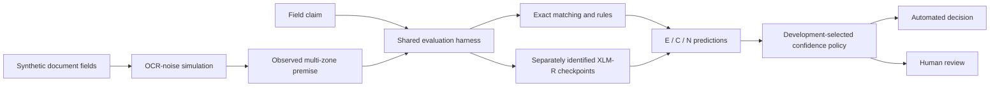

# KYC-NLI

Document-level natural language inference for identity-claim verification under
synthetic cross-script OCR noise.

Given observed document fields and a claim, the systems predict **entailment**,
**contradiction**, or **neutral** (insufficient evidence). A separate confidence
policy determines which decisions are automated and which require human review.
Unresolved human annotation is a status, not a fourth NLI label.

The benchmark uses synthetic multi-zone observations in Latin, Devanagari,
Tamil, Bengali and Perso-Arabic scripts. This representation is not a claim about
the universal layout of real passports. No real identity records are benchmark inputs.

## Current verified results — frozen v1

The current comparison uses 7,000 instances from 1,000 synthetic identities:
4,900 train, 1,050 development and 1,050 test cases, split by identity. A targeted
generator repair changed 56 invalid surname negatives, including six test claims,
while preserving premises and split membership. Historical v0 data remain preserved.

| System | Test macro-F1 [95% CI] | Correct surname contradictions |
| --- | --- | --- |
| Exact matching | 0.269 [0.249, 0.288] | 150/150 |
| Rules | 0.606 [0.569, 0.645] | 147/150 |
| Local XLM-R | 0.981 [0.974, 0.989] | 144/150 |
| Archived XLM-R | 0.844 [0.827, 0.862] | 8/150 |

The neural artifacts are **two distinct recovered XLM-R checkpoints**, with
different weights and matching tokenizer files. They are reported separately,
not treated as independent training seeds. Their original training execution is
not fully authenticated. Evaluation explicitly uses maximum length **192**.

At a common requested **5% automation-error budget**, thresholds are selected on
development data and applied unchanged to test:

| System | Review load | Errors / automated | Observed automation error |
| --- | --- | --- | --- |
| Rules | 93.05% | 0/73 | 0.00% |
| Local XLM-R | 28.57% | 20/750 | 2.67% |
| Archived XLM-R | 57.24% | 25/449 | 5.57% |

Rules and local XLM-R meet the test point-estimate target; archived XLM-R misses
it. Paired review-load saving for local XLM-R versus rules is 64.48 percentage
points [95% CI: 62.09, 66.76]. Realized risks differ. Zero errors in 73 automated
cases is not a population guarantee, and test classification was inspected before
this retrospective selective analysis. Confidence intervals resample contrast
groups, not individual instances.

The **60-case human pilot record** contains 57 candidate labels, three unresolved
cases and one retained human-generator disagreement. Initial agreement is
conditional on only 29 definite pairs; reviewer competence and independence are
self-declared. Frozen generator labels were not replaced by pilot decisions.

Current evidence is limited to the corrected moderate-noise synthetic benchmark.
Historical clean-to-heavy and rule-unreachable claims in earlier reports must not
be combined with these results or presented as newly verified v1 findings.

## Evidence and paper

- [Checkpoint recovery and v0 provenance](docs/v0-recovery-and-trace.md)
- [V1 correction, freeze and separate evaluations](docs/v1-freeze-and-evaluation.md)
- [V1 selective policies and uncertainty](docs/v1-selective-prediction.md)
- [Human-pilot design and final-record status](docs/v1-human-validation-pilot.md)
- [Paper source and build instructions](paper/README.md)
- [Citation and factual-claim audit](docs/literature/paper-citation-audit-2026-10-28.md)
- [Submission and conditional release checklist](docs/paper-submission-status.md)

`paper/main.tex` is the anonymous ACL review draft. Generate the author-visible
version with `scripts/build_author_version.py`; author details and the identifying
repository link are kept out of the anonymous source package. Generated PDFs,
submission ZIPs, private records and experimental outputs remain local.

## Setup

Python 3.10+; model and OCR components are optional extras. See `pyproject.toml`
for exact dependency groups.

```powershell
python -m venv .venv
.\.venv\Scripts\python.exe -m pip install -e ".[dev]"
.\.venv\Scripts\python.exe -m pytest
.\.venv\Scripts\ruff.exe check src tests
```

## Workflows

```powershell
# Generate synthetic examples into a new output path.
.\.venv\Scripts\kyc-nli.exe generate --identities 200 --noise moderate

# Trace and compare recovered artifacts; these require preserved local inputs.
.\.venv\Scripts\kyc-nli.exe trace-v0 --config configs/experiments/v0_trace.yaml
.\.venv\Scripts\kyc-nli.exe freeze-v1 --config configs/experiments/v1_freeze.yaml
.\.venv\Scripts\kyc-nli.exe evaluate-v1 --config configs/experiments/v1_evaluate.yaml
.\.venv\Scripts\kyc-nli.exe selective-v1 --config configs/experiments/v1_selective.yaml

# Prepare blinded worksheets and reconcile received private records.
.\.venv\Scripts\kyc-nli.exe annotation-v1 --config configs/experiments/v1_annotation.yaml
.\.venv\Scripts\kyc-nli.exe pilot-report-v1 --config configs/experiments/v1_pilot_report.yaml

# Build current manuscript figures, tables and prose macros from pinned results.
.\.venv\Scripts\kyc-nli.exe paper-v1 --config configs/experiments/paper_v1.yaml
.\.venv\Scripts\python.exe scripts/check_paper.py
.\.venv\Scripts\python.exe scripts/build_author_version.py

# Local demonstration and explorer.
.\.venv\Scripts\kyc-nli.exe demo
.\.venv\Scripts\kyc-nli.exe serve
```

Configurations identify exact private/local input artifacts; a source checkout
does not include them. Never overwrite a frozen dataset or reuse a historical
result filename for a new experiment. See each evidence report for hashes,
runtime details, source snapshots and the requirements for reproducing a run.
The optional training smoke test is selected with `pytest -m slow`.

## Architecture



The model receives observed serialization only, never clean values or accepted
variant sets. Language configuration, deterministic generation, contrast-group
bootstrap intervals and identity-disjoint splits are enforced by the code/tests.
The local explorer is a demonstration, not a production KYC service or a new
validated real-document OCR pipeline.

## Data, privacy and release

Code and synthetic-data release is planned subject to component licensing review.
Retain the existing code license and upstream notices. Third-party corpora, fonts
and pretrained models have their own terms; do not assume the code license covers
them. Raw reviewer identities, attestations and returned annotation sheets are
private. Only deidentified aggregate findings belong in public reports.

`data/`, `results/` (except `results/MANIFEST.md`), `.env`, checkpoints, local
submission outputs and annotation CSVs are excluded from version control. Do not
force-add them. See `docs/label-definitions.md`, `docs/evaluation-protocol.md` and
the current evidence reports before quoting a result.
