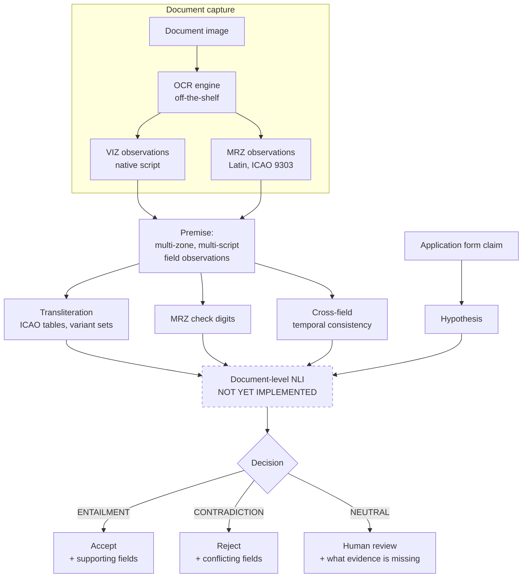

# KYC-NLI

Document-level natural language inference for identity-document field verification, across five scripts.

Identity verification ("KYC") systems check whether the name and dates on a
scanned passport match what someone typed into a form. Almost all of them do
this with string comparison, which fails in a predictable way: an Indian
passport prints `शर्मा` in its regional zone and `SHARMA` in its English zone,
two strings that share zero characters and describe the same person. This
project reformulates that check as three-way entailment — does the document
**support**, **refute**, or **not say** — so that cross-script equivalence,
format variation and OCR corruption are handled by inference instead of by
exact matching.

> **Read this before using any number from this repo.** The Phase-0 pilot found
> that a *deterministic rule engine* reaches 0.980 macro-F1 on noise-free input.
> The defensible contribution is therefore in the OCR-noise regime, not in clean
> cross-script matching. See [Phase-0 finding](#the-phase-0-finding) and
> [`docs/plan.md`](docs/plan.md).

---

## The problem, in three examples

These are the motivating cases. The last column is what a correct system does.

| Case | What the document shows | What the form says | Exact match returns | Correct answer |
| --- | --- | --- | --- | --- |
| **Cross-script name** | Regional zone `சுப்ரமணியன்` (Tamil), English zone `SUBRAMANIYAN` | `SUPRAMANIYAN` | ✗ mismatch → genuine holder rejected | **ENTAILMENT** — Tamil script does not mark voicing, so ப is P or B with equal legitimacy; both spellings are correct romanisations of one name |
| **Jointly impossible dates** | Issue `1995-06-02`, Expiry `2035-06-02`, Template `2020-polycarbonate` | `expires 2035-06-02` | ✓ match → forgery passes | **CONTRADICTION** — every field is individually valid, but a 40-year validity on a template introduced in 2020 cannot exist |
| **Cascading OCR failure** | VIZ surname reads `???????` (conf. 0.05); no other zone carries it | `SHARMA` | ✗ mismatch → treated as fraud | **NEUTRAL** — the document has the answer, this scan does not; route to a human |

The three answers are three different labels. That is the argument for a
three-way formulation over a binary match/no-match one.

## Labels

Full definitions with worked examples: [`docs/label-definitions.md`](docs/label-definitions.md).

- **ENTAILMENT** — the document's evidence, correctly interpreted (across scripts,
  formats and zones), supports the claim.
- **CONTRADICTION** — the evidence refutes it, either directly or by joint
  impossibility across fields.
- **NEUTRAL** — **the premise lacks the evidence to decide.** This is a property
  of the document, not of the model.

That last definition is the project's central commitment. If NEUTRAL meant "the
model isn't sure", the three-way formulation would collapse into binary
classification plus a confidence threshold, which is a solved problem and not a
contribution. See [decision 0002](docs/decisions/0002-neutral-is-evidence-insufficiency.md).

**The boundary everyone gets wrong:** contradiction requires positive evidence
*against*. A blank field is NEUTRAL. A field reading something else is
CONTRADICTION. A field too corrupted to read is NEUTRAL — "looks different after
corruption" is not evidence.

## Architecture



Dashed = not yet built. Everything else runs today, on CPU.

## The Phase-0 finding

The first thing built was not the model — it was the baseline the model has to
beat: a transliteration-aware rule engine with the ICAO Doc 9303 tables, MRZ
check digits, date-format normalisation, cross-field temporal rules and tuned
fuzzy thresholds. Then the benchmark was generated at four OCR-noise levels.

| OCR noise | `exact_match` macro-F1 | **`rule_engine` macro-F1** | contrast consistency | false-mismatch rate |
| --- | --- | --- | --- | --- |
| clean | 0.371 | **0.980** | 0.952 | 0.000 |
| light | 0.359 | **0.903** | 0.793 | 0.098 |
| moderate | 0.353 | **0.831** | 0.652 | 0.133 |
| heavy | 0.285 | **0.649** | 0.396 | 0.156 |

*(5 languages, 120 identities each, seed 20260906; reproduce with
`scripts/run_noise_ablation.ps1`.)*

**A rule engine gets 0.980 on clean input.** There is no room for a neural
contribution there. It degrades steeply under corruption — human review load
rises from 29% to 56% between clean and heavy — so that is where the
contribution has to live. The revised claim is about **selective prediction
under input corruption**, and it is falsifiable by the risk–coverage curve.

Caveat: the noise model is hand-built from documented per-script OCR failure
modes, not calibrated against a real engine. The direction of this finding is
robust; the magnitude is not yet trustworthy. Calibration is milestone M1 and
the project's single point of failure —
[decision 0004](docs/decisions/0004-ocr-noise-is-simulated.md).

## Languages

Five scripts from the **Indian document context** — Latin, Devanagari, Tamil,
Bengali and Perso-Arabic. All five are official Indian languages, and all five
appear on documents issued by one state, so the cross-script comparison is
*in-document* rather than across two countries' records: an Indian identity
document prints the holder's name in English and a regional script on the same
card. [Decision 0005](docs/decisions/0005-indian-language-set.md) has the full
rationale.

| code | script | romanisation | normative | probes |
| --- | --- | --- | --- | --- |
| `en` | Latin | identity | full | Control — the English zone the other four are compared *against*, not an artificial baseline |
| `hi` | Devanagari | ITRANS / IAST / ad-hoc | **none** | The same holder romanises their own name differently on different forms |
| `ta` | Tamil | none | **none** | **The script does not mark voicing at all** — க is K or G, ப is P or B, equally correctly. A lookup table cannot be right even in principle |
| `bn` | Bengali | none | **none** | Inherent vowel nearer /o/ (BASU/BOSE), no /v/, ya-phala shares a letter with /dʒ/ (BANDYOPADHYAY/BANDOPADHYAY) |
| `ur` | Perso-Arabic | ICAO 9303 Arabic, extended | partial | Short vowels unwritten: the script gives a skeleton (SDYQY), a lexicon supplies the rest (SIDDIQUI) |

Four of five are non-normative or partial — the set is concentrated on the regime
where the project's claim could be true. Measured romanisation recall of the rule
engine against the attested spellings: en 100%, hi 90%, ta 92%, bn 100%, ur 98%.
The residual needs schwa *epenthesis*, monophthongisation or Grantha conjunct
handling, and is reported rather than tuned away.

Nothing hardcodes a language. Adding a sixth is a block in
`configs/languages.yaml` plus a name pool. Russian and Chinese are retained in
code as contrast conditions — a normative-table language and a false-*match*
language — so "does this generalise beyond India?" is a config edit.

## Installation

From a clean machine. No GPU required for anything in this repo.

```bash
git clone <your-remote-url> kyc-nli
cd kyc-nli
python -m venv .venv
```

```bash
.venv/Scripts/python -m pip install -e ".[dev]"
```

On macOS/Linux use `.venv/bin/python` instead. Python 3.10+ (developed on 3.13).

Optional extras: `.[nli]` for the Phase-1 GPU work (install on Colab, not
locally), `.[ocr]` for a real OCR engine, `.[translit]` for pypinyin and
indic-transliteration.

## Quickstart

Smallest command producing a real result — about 20 seconds end to end:

```bash
.venv/Scripts/kyc-nli generate --identities 50 && .venv/Scripts/kyc-nli compare
```

Then look at actual instances before trusting any number:

```bash
.venv/Scripts/kyc-nli inspect --language ta --phenomenon cross_script_name_icao -n 2
```

Other commands: `kyc-nli languages`, `kyc-nli run-baseline rule_engine`.

## Data

**No real identity document, and no real person's data, is stored in this
repository or produced by it.** Every generated instance asserts
`provenance.contains_real_pii = False`, and the test suite fails if that is ever
untrue. `.gitignore` blocks `data/`, `results/` and all image and PDF extensions
repo-wide as a second guard.

| Source | Used for | License | Status |
| --- | --- | --- | --- |
| `kyc_nli.data.name_pools` (embedded) | fabricated names for all 5 languages | MIT (this repo) | ✅ in use |
| Dakshina | **all four** non-English languages: native/romanised lexicon pairs for hi, ta, bn, ur | CC BY-SA 4.0 | planned (M2) |
| MIDV-2020 | document templates, mock identities; OCR noise calibration | free for research — **redistribution terms must be confirmed before releasing derived annotations** | planned (M1) |

The embedded pools pair common given names with common surnames at random. A
randomly paired name carries no identifying information, and this is what lets
the repo run on a clean checkout with zero downloads.

## Reproducing the results

| Output | Command |
| --- | --- |
| Baseline comparison table | `kyc-nli generate && kyc-nli compare` |
| Full report for one system | `kyc-nli run-baseline rule_engine` |
| Noise ablation (README table) | `scripts/run_noise_ablation.ps1` |
| Test suite | `.venv/Scripts/python -m pytest` |
| Regenerate the corrected Review 1 deck | `python scripts/fix_review1_citations.py "docs/proposal/NLP review 1.pptx" "docs/proposal/NLP review 1 (corrected).pptx"` |
| Lint | `.venv/Scripts/ruff check src tests` |

Every number is reproducible from a config plus a seed. Results land in
`results/`, which is gitignored except its manifest.

## Repository layout

```
configs/          experiment + language configs (languages.yaml is the source of truth)
data/             all datasets — GITIGNORED, never committed
docs/
  plan.md         the project plan, feasibility gates, risk register
  label-definitions.md    ground truth for annotation
  evaluation-protocol.md  frozen reporting protocol
  decisions/      numbered architecture decision records
  proposal/       Review 1 deck, its corrected version, and the mid-review deck
  literature/     citation-audit.md -- all 12 references checked against source
notebooks/        exploratory only, numbered, outputs stripped
src/kyc_nli/
  schema.py       the data model — start here
  languages.py    language registry loaded from config
  data/           name pools, MRZ construction, instance generator, IO + splits
  ocr/            script-aware corruption model
  translit/       ICAO + non-normative transliteration engines
  consistency/    cross-field rules (currently inside baselines/rules.py)
  nli/            neural models — NOT YET IMPLEMENTED
  baselines/      exact match (weak) and rule engine (the one that matters)
  evaluation/     metrics, risk-coverage
  cli.py          every experiment entry point
tests/            dataset-integrity and correctness tests
scripts/          one script per reproducible experiment
results/          metrics + figures, gitignored except MANIFEST.md
```

## Status and roadmap

- [x] **M0** Schema, generator, MRZ encoder, transliteration engines, OCR noise model, rule baseline, evaluation harness
- [x] Phase-0 pilot and go/no-go signal
- [ ] **M1** Calibrate the noise model against a real OCR engine on MIDV-2020 — *critical path*
- [ ] **M2** Replace embedded name pools with Dakshina (covers all four non-English languages)
- [ ] **M3** Fine-tuned mDeBERTa-v3-base cross-encoder (Colab/Kaggle GPU)
- [ ] **M4** Selective-prediction analysis: risk–coverage, review-load reduction
- [ ] **M5** Human-labelled 500-instance validation subset, inter-annotator agreement
- [ ] **M6** Ablations and error analysis
- [ ] **M7** Write-up
- [ ] Bootstrap confidence intervals (required before M3 results are reported)
- [ ] TD1 (ID-card) MRZ support; currently TD3 passport only

## Citation

```bibtex
@misc{arya2026kycnli,
  title  = {KYC-NLI: Document-Level Natural Language Inference for Identity Verification},
  author = {Arya, Stuti},
  year   = {2026},
  note   = {Work in progress}
}
```

## License

MIT — see [LICENSE](LICENSE). Note that this covers the code and the embedded
synthetic name pools only; external corpora carry their own licenses, listed in
the Data section above.
