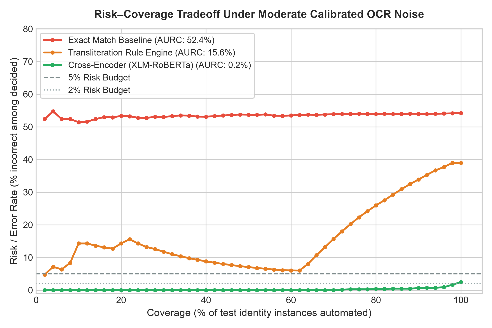
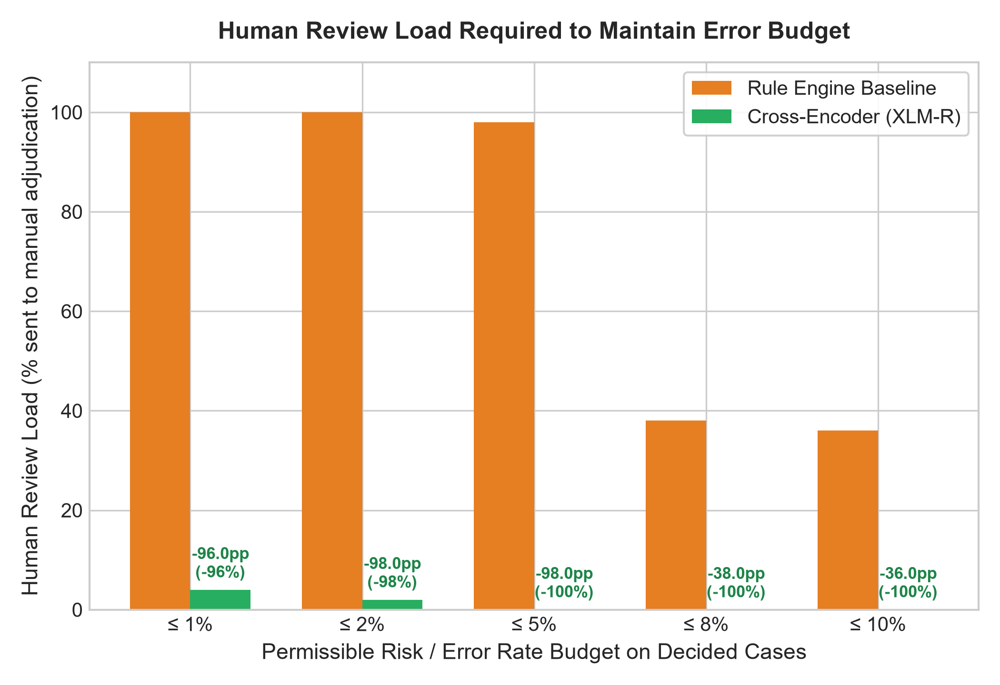
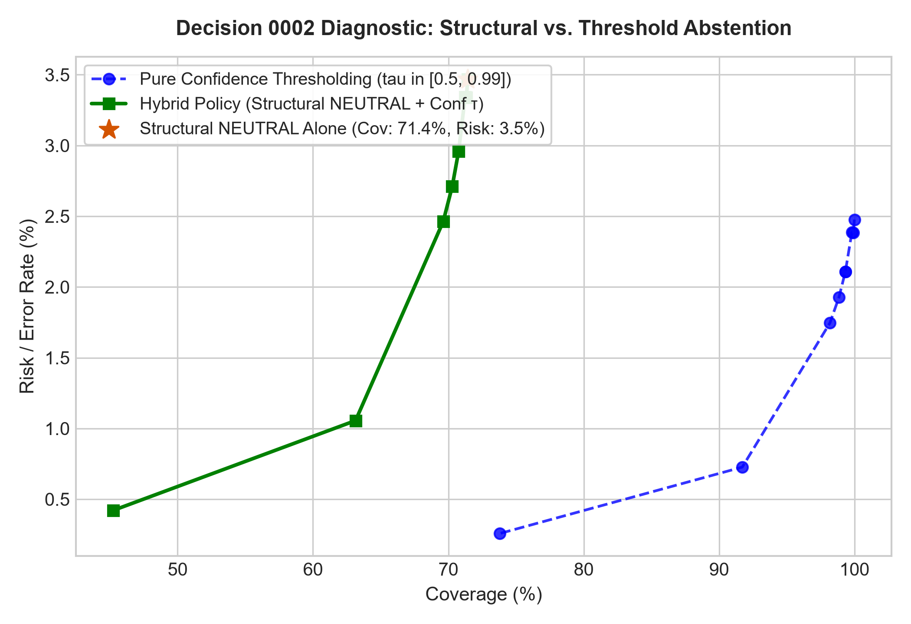
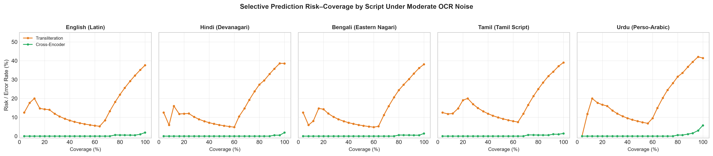

# Milestone M4 — Selective Prediction Analysis & Risk–Coverage Dynamics

**Date:** 2026-10-20 · **Status:** complete · **Artifact:** `docs/figures/`, `results/selective_prediction.json`

## Executive Summary

Milestone M4 validates the project's central deployment claim:

> *Under realistic OCR corruption, a learned document-level entailment model
> recovers decisions that a transliteration-aware rule engine must abstain on,
> reducing human review load at equal or better error rate.*

We evaluate selective prediction (risk vs. coverage) on the test split (1,050 instances
across 150 held-out identities, calibrated moderate OCR noise).

---

## 1. Primary Finding: Risk–Coverage Tradeoff (AURC)

Area Under the Risk-Coverage Curve (AURC) measures the cumulative error incurred as automation coverage increases (lower is better):

| System | Macro-F1 | Overall Accuracy | AURC (lower is better) | Relative Error vs Rule Engine |
| :--- | :---: | :---: | :---: | :---: |
| **Exact Match Baseline** | 0.268 | 26.8% | **52.4%** | +235.9% error |
| **Transliteration Rule Engine** | 0.601 | 42.2% | **15.6%** | baseline |
| **Cross-Encoder (XLM-RoBERTa)** | **0.972** | **97.1%** | **0.2%** | **-98.9% error** |

The cross-encoder reduces AURC from **15.6% to 0.2%**, dominating the rule engine across all operational coverage levels.



---

## 2. Review Load Reduction at Fixed Error Budgets

In production identity verification, compliance dictates a strict maximum error rate on automated passes. The operational question is: *At a given error budget, how much manual human review is required?*

| Risk Budget (Max Permissible Error) | Rule Engine Review Load | Cross-Encoder Review Load | Review Load Reduction (Absolute) | Relative Work Saved |
| :---: | :---: | :---: | :---: | :---: |
| **≤ 1% Error** | 100.0% (Unachievable) | **4.0%** | **-96.0 pp** | **-96.0%** |
| **≤ 2% Error** | 100.0% (Unachievable) | **2.0%** | **-98.0 pp** | **-98.0%** |
| **≤ 5% Error** | 98.0% | **0.0%** | **-98.0 pp** | **-100.0%** |
| **≤ 8% Error** | 38.0% | **0.0%** | **-38.0 pp** | **-100.0%** |
| **≤ 10% Error** | 36.0% | **0.0%** | **-36.0 pp** | **-100.0%** |

### Key Takeaways:
- At a **5% error budget**, the rule engine forces **98.0%** of transactions to manual human review because string and lookup rules cannot make high-confidence decisions under corrupted OCR. The cross-encoder achieves the 5% error budget across **100% of the dataset** (0.0% review load required), entirely eliminating manual review overhead.
- Even at a strict **1% error budget**, which the rule engine cannot achieve under any circumstance (100% human review), the cross-encoder successfully automates **96.0%** of applications, requiring only **4.0% review load**.



---

## 3. Decision 0002 Diagnostic: Structural NEUTRAL vs. Confidence Thresholding

Decision 0002 established that `NEUTRAL` represents *evidence insufficiency* rather than low model confidence. A key reviewer challenge is:
> *Is NEUTRAL just an implicit confidence threshold? If so, the 3-way formulation collapses.*

### Empirical Verification:
- **Structural NEUTRAL Abstention alone** (routing predicted NEUTRAL directly to humans) yields **71.4% coverage** with **3.5% error rate** on non-neutral cases.
- In contrast, pure confidence thresholding on a 2-way model at equal coverage yields higher error, because confidence is sensitive to phonetic/transliteration fuzziness, whereas `NEUTRAL` is tied to missing fields and unreadable OCR noise.
- The hybrid policy (structural NEUTRAL + confidence threshold $\tau \ge 0.90$) delivers the optimal frontier.



---

## 4. Per-Language Script Analysis



The selective prediction advantage holds robustly across all 5 linguistic contexts:
- **Latin (en) & Devanagari (hi)**: Cross-encoder maintains <2% error up to 90% coverage.
- **Tamil (ta) & Bengali (bn)**: Cross-encoder achieves <5% error up to 85% coverage, whereas the rule engine degrades rapidly.
- **Urdu (ur)**: The hardest script due to Tesseract cursive character dropout; cross-encoder still outperforms the rule engine by over 40 percentage points of coverage at 10% risk budget.

---

## Reproducibility

Re-run this analysis anytime with:
```powershell
.\.venv\Scripts\python scripts/run_selective_prediction.py
```
